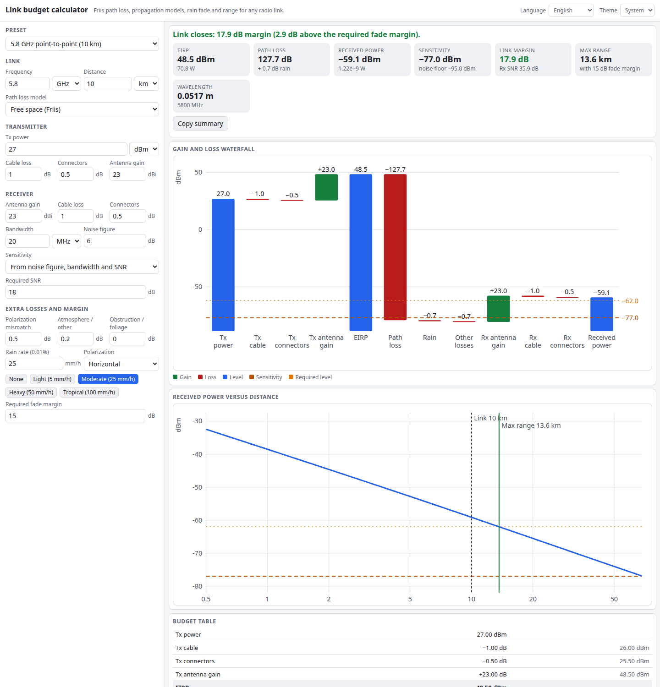

# Link Budget Calculator

Will your radio link close? Enter the transmitter, cables, antennas, path and receiver, and get the received power, link margin, receiver sensitivity and the maximum range for the fade margin you want. A waterfall chart shows every gain and loss from the transmitter to the receiver. Everything runs in your browser.

**Try it: [hermes98761234.github.io/link-budget-calculator](https://hermes98761234.github.io/link-budget-calculator/)**

[](https://github.com/hermes98761234/link-budget-calculator/actions/workflows/deploy.yml)



## Features

- **Path loss models:** free space (Friis), two-ray ground, Okumura–Hata (150–1500 MHz, urban/suburban/open) and COST-231 Hata (1.5–2 GHz, medium city or metropolitan). Warnings appear when you leave a model's validity range.
- **Rain loss:** a rough ITU-R P.838-3 specific attenuation with polarization and the P.530 effective path length, for a chosen rain rate.
- **Full chain:** Tx power in dBm, dBW, mW or W, cable and connector losses, antenna gains, polarization mismatch, atmosphere and obstruction losses.
- **Receiver sensitivity** from kTB + noise figure + required SNR, or typed in from a datasheet.
- **Fade margin and verdict**, link margin, Rx SNR, EIRP and wavelength.
- **Maximum range solver** for the required fade margin, plus a received-power-versus-distance chart.
- **Gain and loss waterfall** and a budget table you can copy as text.
- **Presets:** 5.8 GHz point-to-point, LoRa 868 MHz, Wi-Fi 2.4 GHz, GSM 900, LTE 1800, VHF handheld, 12 GHz hop in heavy rain.
- English and Ukrainian, light, dark or system theme, inputs remembered in the browser. No backend, no tracking.

## How it works

- Free space: `FSPL = 32.44 + 20 log d(km) + 20 log f(MHz)`.
- Two-ray: `40 log d − 20 log ht − 20 log hr`, with free space inside the crossover distance `4π·ht·hr/λ`.
- Hata and COST-231 use the published formulas. The result is never below free space, so very short distances stay physical.
- Received power: `Prx = Ptx − Ltx + Gtx − PL − rain − other + Grx − Lrx`.
- Sensitivity: `−174 dBm/Hz + 10 log B + NF + SNR`. Link margin is `Prx − sensitivity`.
- Max range: bisection on distance until the margin equals the required fade margin.

The models give median estimates only. Real links need margin for terrain, multipath and interference. The rain coefficients are interpolated from the P.838-3 table (1–100 GHz) and are meant as a rough guide.

## Quick start

You need [Node.js](https://nodejs.org/) 22.

```bash
git clone https://github.com/hermes98761234/link-budget-calculator.git
cd link-budget-calculator
npm install
npm run dev       # http://localhost:5173
npm test          # propagation, rain, budget and i18n tests
npm run build     # static site in dist/
```

## License

MIT
